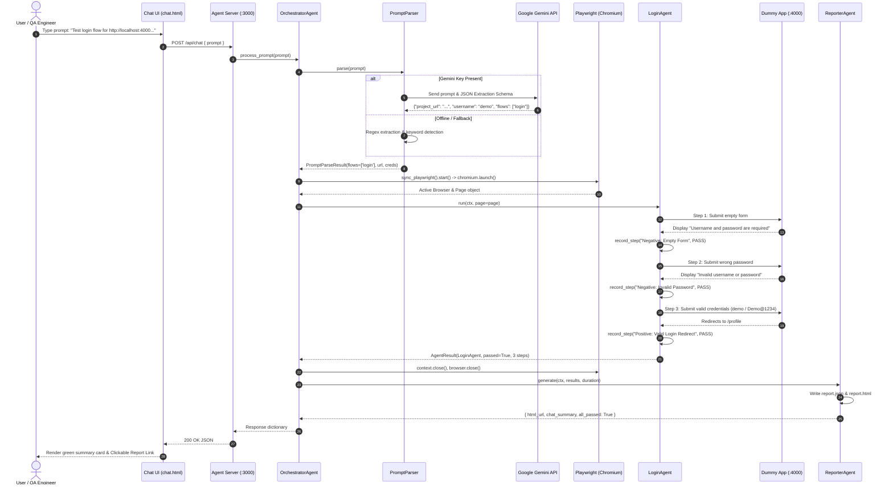

# 🚀 AI Automation Tester — Complete Beginner-Friendly Hinglish Learning Guide

> **Mentor Note**: 
> Agar aapka background non-technical hai, ya aap pehli baar Backend Architecture, AI Agents, aur Browser Automation jaise concepts seekh rahe hain — toh fikar bilkul mat kijiye! Is guide ko bilkul zero level se step-by-step likha gaya hai. Is guide ko padhne ke baad aap is project ko kisi bhi developer, intern ya technical interviewer ke saamne poore confidence ke saath explain kar payenge.

---

## 📑 Table of Contents (Index)

1. [Chapter 1: Project Introduction (Ye Project Kya Hai Aur Kyun Hai?)](#chapter-1-project-introduction)
2. [Chapter 2: Real-Life Analogy Se Project Samajhte Hain](#chapter-2-real-life-analogy-se-project-samajhte-hain)
3. [Chapter 3: Folder Structure Aur Har File Ka Deep Dive](#chapter-3-folder-structure-aur-har-file-ka-deep-dive)
4. [Chapter 4: Complete End-to-End Execution Flow](#chapter-4-complete-end-to-end-execution-flow)
5. [Chapter 5: Technology Stack — A To Z Guide](#chapter-5-technology-stack--a-to-z-guide)
6. [Chapter 6: AI vs Automation — Dono Ko Alag-Alag Samajhte Hain](#chapter-6-ai-vs-automation--dono-ko-alag-alag-samajhte-hain)
7. [Chapter 7: Login, Registration Aur Profile Flows Ka Deep Dive](#chapter-7-login-registration-aur-profile-flows-ka-deep-dive)
8. [Chapter 8: Reports Aur Failure Handling System](#chapter-8-reports-aur-failure-handling-system)
9. [Chapter 9: Run The Project Yourself (Step-by-Step Windows Guide)](#chapter-9-run-the-project-yourself)
10. [Chapter 10: Debugging Aur Common Errors Ka Solution](#chapter-10-debugging-aur-common-errors-ka-solution)
11. [Chapter 11: How To Explain This Project To Other People](#chapter-11-how-to-explain-this-project-to-other-people)
12. [Chapter 12: Learning Roadmap, 20 Q&A Aur Self-Assessment](#chapter-12-learning-roadmap-20-qa-aur-self-assessment)

---

## Chapter 1: Project Introduction

### 1.1 Ye Project Exactly Kya Hai?
Ye project ek **AI-Powered Automated Quality Assurance (QA) System** hai. 

Iska seedha matlab ye hai:
Aapko testing ke liye koi code likhne ya manual buttons click karne ki zaroorat nahi hai. Aap chat box mein normal English (Natural Language) mein bolenge:
> *"Test login flow for http://localhost:4000 with username demo and password Demo@1234"*

Aur hamara system:
1. Aapki English baat ko samjhega (AI ki madad se).
2. Chrome/Chromium browser ko peeche automatically open karega.
3. Website par jaakar button click karega, galat password daal kar dekhega error aa raha hai ya nahi, sahi password daal kar check karega redirect hua ya nahi.
4. Agar kahin koi bug ya error aaya, toh uski screenshot kheenchega.
5. Aakhiri mein ek sundar **HTML dashboard** aur **JSON report** bana kar aapke chat interface par link de dega!

---

### 1.2 Automation Testing Kya Hoti Hai?
* **Simple Definition**: Computer ko instructions dena taaki insaan ki jagah computer khud website ya app ko use karke test kare ki sab theek chal raha hai ya nahi.
* **Real-life Example**: Maan lijiye aapki dukaan ka ek tala hai. Har subah insaan aakar chaabi ghumata hai ki tala khul raha hai ya nahi — ye **Manual Testing** hai. Agar hum ek robotic sensor laga dein jo har subah 8 baje khud check kare aur report mobile par bhej de — ye **Automation Testing** hai.
* **Technical Definition**: Software code (jaise Playwright scripts) likhkar web elements (input box, button) ke saath programmatic interactions perform karna aur assertions (expected vs actual result checks) verify karna.

---

### 1.3 AI Automation Tester Agent Kya Hota Hai?
Normal automation tools (jaise puraana Selenium) tabhi chalte hain jab ek technical engineer code likhta hai ya specific button dabata hai. 

Lekin **AI Agent** ek step aage hai:
* Ye **Natural Language (aam bolchaal ki bhasha)** ko samajhta hai.
* Ye decide karta hai ki user ke prompt mein target URL kya hai, username kya hai, password kya hai, aur user exactly kaun sa flow test karwana chahta hai (sirf Login? sirf Registration? ya poori website?).
* Uske baad execution ko orchestrate (manage) karke report deliver karta hai.

---

### 1.4 Humne Ye Project Kyun Banaya?
1. **Manual Testing Boring aur Time-Consuming Hoti Hai**: Ek QA engineer ko har naye release par wahi 50 buttons baar-baar click karke dekhne padte hain (Regression testing).
2. **Non-Technical Log Testing Trigger Kar Sakein**: Product manager, client ya non-technical QA ko complex testing framework seekhne ki zaroorat na pade; wo sirf chat mein prompt likhein aur test run ho jaye.
3. **Audit Trail & Proof**: Har test run ka exact execution time, passed/failed status, aur failure screenshot automatically archive ho jata hai.

---

### 1.5 Is Project Mein AI Ka Kya Role Hai? Aur Playwright Ka Kya Role Hai?
Bohot saare log confuse ho jaate hain ki AI browser chala raha hai ya nahi. Yahan clear samajh lijiye:

| Role | Kon Karta Hai? | Asli Kaam |
| :--- | :--- | :--- |
| **Dimag (Brain / Understanding)** | **Google Gemini (AI Model)** | User ke message ko padhna aur usme se information extract karna (URL, username, password, flow name). |
| **Hath-Pair (Hands & Feet / Action)** | **Playwright (Browser Engine)** | Browser kholna, website par jana, keyboard typing karna, button click karna, screenshot lena. |

> [!IMPORTANT]
> **Key Insight**: Google Gemini khud mouse ya keyboard nahi hilata! Gemini sirf instructions ko "parse" karta hai (samajhta hai). Asli browser action **Playwright** karta hai.

---

### 1.6 Normal Manual Testing vs Traditional Automation vs Hamara AI Agent

| Feature | Manual Testing | Traditional Automation (Selenium/Cypress) | Hamara AI Tester Agent |
| :--- | :--- | :--- | :--- |
| **Trigger Karne Ka Tarika** | Insaan screen dekh kar mouse hilata hai | Tester terminal mein command ya code run karta hai | User Chat UI mein simple English prompt likhta hai |
| **Speed** | Slow (Minutes/Hours) | Fast (Seconds) | Fast + Zero Code input |
| **Skill Required** | Basic computer knowledge | Heavy coding & framework knowledge | Sirf plain English likhna aana chahiye |
| **Failure Proof** | Tester ko khud screenshot save karni padti hai | Code mein try/catch likho tab hoti hai | System automatic full-screen screenshot capture karta hai |
| **Reporting** | Excel sheet mein manual entry | Raw terminal output ya XML | Beautiful Interactive HTML Dashboard + JSON |

---

### 1.7 Kya Ye Agent Har Kisi Website Ko Test Kar Sakta Hai? (Current Capabilities vs Limitations)

#### ✅ Current Capabilities (Abhi Kya Kar Sakta Hai):
1. **Chat-driven Testing**: Web chat ke through prompt accept karta hai.
2. **Modular Flows Support**:
   - **Registration Flow**: Empty inputs, invalid email format, password mismatch, aur fresh random user generate karke valid registration.
   - **Login Flow**: Empty credentials, invalid password, aur correct login redirect to `/profile`.
   - **Profile Flow**: Login session check, view profile data, edit name & phone, save, reload persistence check, aur logout.
3. **Smart Prompt Parsing**: Google Gemini AI model use karta hai; aur agar internet ya API key na ho toh fallback Regex parser bhi rakha gaya hai.
4. **Comprehensive Reporting**: Har run ka alag timestamped folder banta hai jisme `report.html`, `report.json`, aur failure images save hoti hain.
5. **Jira Integration Ready**: Code ke andar Jira Cloud ke sath issue create karne aur status check karne ka setup integrated hai.

#### ⚠️ Current Limitations (Abhi Kya Nahi Kar Sakta — Jo Interview Mein Batana Zaroori Hai):
1. **Dynamic Selector Generation Nahi Hai**: Ye agent kisi bilkul unknown nayi website (jaise Amazon, Flipkart) par jaakar khud inspect karke naye buttons dhoondh kar test cases on-the-fly invent nahi karta.
2. **Pre-configured Page Object Model (POM)**: Abhi iske paas hamare target project (`dummy_app`) ke selectors (`data-testid`) pre-defined hain.
3. **Agar Nayi Website Test Karni Hai Toh**: Hume us nayi website ke Page Objects (`*.page.py`) aur Test Cases (`*_cases.py`) define karne honge.

---

## Chapter 2: Real-Life Analogy Se Project Samajhte Hain

Project ko aasaani se samajhne ke liye ek software company ke **QA Testing Department** ki real-life analogy lete hain:

```text
               +-------------------------------------------------------+
               |                  USER / QA ENGINEER                   |
               |       (Company ka Client ya Product Manager)          |
               +---------------------------+---------------------------+
                                           |
                                (1) Chat Order Deta Hai
                                           v
               +-------------------------------------------------------+
               |                   CHAT UI (chat.html)                 |
               |            (Reception Desk / Order Window)            |
               +---------------------------+---------------------------+
                                           |
                              (2) Order Transfer Karta Hai
                                           v
               +-------------------------------------------------------+
               |                FLASK SERVER (server.py)               |
               |                (Office Dispatch Manager)              |
               +---------------------------+---------------------------+
                                           |
                                  (3) Task Assign Karta Hai
                                           v
               +-------------------------------------------------------+
               |          ORCHESTRATOR AGENT (orchestrator_agent.py)   |
               |                 (Team Lead / Project Manager)         |
               +-------------+---------------------------+-------------+
                             |                           |
             (4) English Samajhne Bhejta Hai             | (6) Action Order Deta Hai
                             v                           v
              +-------------------------------+  +-------------------------------+
              | PROMPT PARSER + GEMINI API    |  | AUTOMATION AGENTS / CASES     |
              | (Translator & Language Expert)|  | (Senior QA Execution Engineers|
              +-------------------------------+  +---------------+---------------+
                                                                 |
                                                    (7) Standard Playbook Use Karke
                                                                 v
                                                 +-------------------------------+
                                                 | PAGE OBJECT MODEL (POM)       |
                                                 | (Building Map & Wireframe)    |
                                                 +---------------+---------------+
                                                                 |
                                                    (8) Robotic Hands Ko Chalata Hai
                                                                 v
                                                 +-------------------------------+
                                                 | PLAYWRIGHT BROWSER ENGINE     |
                                                 | (Robotic Hands & Fingers)     |
                                                 +---------------+---------------+
                                                                 |
                                                    (9) Testing Perform Karta Hai
                                                                 v
                                                 +-------------------------------+
                                                 | TARGET APPLICATION (dummy_app)|
                                                 | (Website Under Test)          |
                                                 +---------------+---------------+
                                                                 |
                                                    (10) Result Collect Karta Hai
                                                                 v
                                                 +-------------------------------+
                                                 | REPORTER AGENT                |
                                                 | (Documentation Clerk)         |
                                                 +-------------------------------+
```

---

### Component-by-Component Analogy & Technical Breakdown

#### 1. User / QA Engineer (Client)
* **Analogy**: Wo person jo office mein aakar order deta hai: *"Mujhe login check karke batao sab theek hai ya nahi."*
* **Ye Kya Hai?**: Aap ya testing team member jo natural language prompt deta hai.
* **Input**: Apne man ki baat (Text Prompt).
* **Output**: Final test summary aur report link.

#### 2. Chat UI (`agent/chat/chat.html`)
* **Analogy**: Office ka Reception Counter. Yahan client aakar form bharta hai aur result ka wait karta hai.
* **Ye Kya Hai?**: Ek modern responsive web page jo browser par chalta hai (`http://localhost:3000/chat`).
* **Kyun Zaroori Hai?**: Agar ye na ho toh non-technical user ko API tools (jaise Postman ya Curl) use karne padenge jo unke liye mushkil honge.
* **Input**: User ka typed text.
* **Output**: JSON payload jo Flask server ko `POST /api/chat` ke zariye bheja jata hai.

#### 3. Flask Server (`agent/server.py`)
* **Analogy**: Office Dispatch Manager jo orders receive karta hai aur sahi department ko aage pass karta hai.
* **Ye Kya Hai?**: Python ka lightweight web framework jo HTTP requests sunta hai.
* **Kyun Zaroori Hai?**: Frontend (HTML/JS) aur Backend (Python code) ke beech communication establish karne ke liye.
* **Input**: HTTP POST request (`/api/chat`).
* **Output**: Orchestrator ka response JSON format mein frontend ko wapas bhejta hai.

#### 4. Orchestrator Agent (`agent/orchestrator/orchestrator_agent.py`)
* **Analogy**: Company ka Testing Team Lead / Manager.
* **Ye Kya Kaam Karta Hai?**: 
  1. Translator se prompt samajhta hai.
  2. Browser launch karta hai.
  3. Kaun-kaun se flows test hone hain unki list banata hai.
  4. Ek-ek karke testing agents ko run karta hai.
  5. Reporter ko bolta hai final report generate karo.
* **Agar Ye Na Ho Toh?**: System mein koi coordination nahi hoga; components aapas mein sync nahi ho payenge.

#### 5. Prompt Parser (`agent/orchestrator/prompt_parser.py`) & Gemini API
* **Analogy**: Office ka Translator / Language Specialist.
* **Ye Kya Kaam Karta Hai?**: User ki unstructured English ("*Test login flow for http://localhost:4000 with username demo and password Demo@1234*") ko padhkar structured data (Python Dictionary / Pydantic Model) banata hai:
  ```json
  {
    "project_url": "http://localhost:4000",
    "username": "demo",
    "password": "Demo@1234",
    "flows": ["login"]
  }
  ```
* **Kyun Zaroori Hai?**: Computer direct aam bolchaal ki language ko samajhkar code parameters nahi bana sakta.

#### 6. Automation Sub-Agents (`agent/agents/`) & Test Cases (`agent/test_cases/`)
* **Analogy**: Senior QA Execution Engineers jinhe pata hai ki Login kaise test kiya jata hai aur Registration kaise test kiya jata hai.
* **Ye Kya Kaam Karta Hai?**: Har flow ke specific steps run karta hai (Negative test case pehle, phir Positive test case).
* **Input**: Browser Page aur User Credentials (`TestContext`).
* **Output**: `AgentResult` jisme har step ka pass/fail status aur duration hota hai.

#### 7. Page Object Model - POM (`agent/pages/`)
* **Analogy**: Target website ka Architectural Blueprint ya Map.
* **Ye Kya Kaam Karta Hai?**: Isme likha hota hai ki Login button ka address (selector) kya hai, password box kahan hai.
* **Kyun Zaroori Hai?**: Agar kal ko developer button ka naam badal de, toh sirf is ek file mein change karna padega; poore test cases nahi tootenge!

#### 8. Playwright Browser Engine
* **Analogy**: Robotic Hands and Eyes.
* **Ye Kya Kaam Karta Hai?**: Actual Chromium browser kholta hai, button click karta hai, aur webpage screen ki photo (screenshot) leta hai.

#### 9. Dummy Application (`dummy_app/`)
* **Analogy**: Dummy practice dummy ya car crash test dummy jisko test kiya ja raha hai.
* **Ye Kya Hai?**: Port 4000 par chalne wali hamari target web application jisme Register, Login aur Profile pages bane hue hain.

#### 10. Reporter Agent (`agent/agents/reporter_agent.py`)
* **Analogy**: Documentation Clerk jo saare testing logs collect karke official beautiful report print karta hai.
* **Output**: `report.json` aur `report.html` file.

---

## Chapter 3: Folder Structure Aur Har File Ka Deep Dive

Project root directory ka complete verified folder structure:

```text
ai-automation-tester/
├── .env                              # Environment variables (API keys, ports)
├── .env.example                      # Configuration template
├── .gitignore                        # Git exclusion rules
├── mypy.ini                          # Strict type-checking config
├── pytest.ini                        # Pytest configuration
├── requirements.txt                  # Python dependencies
├── run.py                            # Master Task Runner (CLI)
├── README.md                         # Quick reference guide
├── PROJECT_ARCHITECTURE.md           # Complete architectural and flow documentation
│
├── agent/                            # Main AI Test Engine Package
│   ├── __init__.py                   # Package initializer
│   ├── agent.py                      # Re-export alias (AutomationAgent = OrchestratorAgent)
│   ├── models.py                     # Pydantic data schemas & contracts
│   ├── server.py                     # Flask web server for Chat UI (:3000)
│   │
│   ├── orchestrator/                 # Workflow Coordination & Language Parsing
│   │   ├── __init__.py
│   │   ├── orchestrator_agent.py     # Main Workflow Controller (OrchestratorAgent)
│   │   └── prompt_parser.py          # Google Gemini + Regex fallback parser
│   │
│   ├── agents/                       # Flow-Specific Execution Sub-Agents
│   │   ├── __init__.py
│   │   ├── base_agent.py             # Abstract base agent with timing & error handler
│   │   ├── registration_agent.py     # Registration flow sub-agent
│   │   ├── login_agent.py            # Login flow sub-agent
│   │   ├── profile_agent.py          # Profile flow sub-agent
│   │   └── reporter_agent.py         # Report generation agent (HTML & JSON)
│   │
│   ├── test_cases/                   # Modular Test Case Implementation Classes
│   │   ├── __init__.py               # Registry mapping (TEST_CASE_REGISTRY)
│   │   ├── base_case.py              # Abstract base test case class
│   │   ├── registration_cases.py     # RegistrationTestCase implementation
│   │   ├── login_cases.py            # LoginTestCases implementation
│   │   └── profile_cases.py          # ProfileTestCases implementation
│   │
│   ├── pages/                        # Page Object Model (POM) Locators & Actions
│   │   ├── __init__.py
│   │   ├── registration_page.py      # Registration page POM
│   │   ├── login_page.py             # Login page POM
│   │   └── profile_page.py           # Profile page POM
│   │
│   ├── integrations/                 # External System Connectors
│   │   ├── __init__.py
│   │   ├── jira_config.py            # Jira environment configuration loader
│   │   └── jira_client.py            # Jira REST API client for bug creation
│   │
│   ├── utils/                        # Helper Utilities
│   │   ├── __init__.py
│   │   ├── data_generator.py         # Random user data generator
│   │   ├── logger.py                 # Credential-masked console logger
│   │   └── screenshot.py             # Playwright screenshot capture helper
│   │
│   ├── chat/                         # Agent Chat UI Assets
│   │   └── chat.html                 # Interactive chat interface web page
│   │
│   ├── reports/                      # Output directory for test reports
│   │   └── <timestamp>/              # Individual run folders (report.html, report.json, *.png)
│   │
│   └── tests/                        # Standalone Pytest Test Suite
│       ├── __init__.py
│       ├── conftest.py               # Shared Pytest fixtures & auto dummy-app starter
│       ├── test_login.py             # Standalone login tests
│       ├── test_registration.py      # Standalone registration tests
│       ├── test_profile.py           # Standalone profile tests
│       └── test_jira.py              # Standalone Jira integration tests
│
└── dummy_app/                        # Target Application Being Tested
    ├── server.py                     # Flask backend with in-memory DB (:4000)
    └── public/                       # Frontend HTML pages
        ├── login.html                # Login screen
        ├── register.html             # Registration screen
        └── profile.html              # Profile viewing & editing screen
```

---

### Detailed File-by-File Breakdown

#### 1. `run.py` (Project Root)
* **Path**: `run.py`
* **Purpose**: Ye hamara **Single Command-Line Interface (CLI) Task Runner** hai. Iska kaam hai different servers aur tests ko ek simple command se run karna.
* **Important Functions**:
  - `run_dummy()`: Target dummy app ko Port 4000 par start karta hai.
  - `run_agent()`: Agent server ko Port 3000 par start karta hai.
  - `run_dev()`: Python ke `subprocess.Popen` ke zariye dono servers ko parallel start kar deta hai.
  - `run_test()`: Pytest command run karta hai.
* **Kaise Use Hota Hai?**: Terminal mein likhte hain `python run.py dev`.
* **Beginner Tip**: Sabse pehle isi file ko dekhein kyunki yahi se project chalu hota hai.

#### 2. `agent/agent.py`
* **Path**: `agent/agent.py`
* **Purpose**: Backward-compatibility alias file.
* **Code Implementation**:
  ```python
  from agent.orchestrator.orchestrator_agent import OrchestratorAgent
  AutomationAgent = OrchestratorAgent
  __all__ = ["AutomationAgent", "OrchestratorAgent"]
  ```
* **Architectural Reality**: Documentations mein ise `AutomationAgent` likha gaya hai, lekin code mein ye `OrchestratorAgent` ko point karta hai taaki purane imports na tootein.

#### 3. `agent/models.py`
* **Path**: `agent/models.py`
* **Purpose**: **Data Contracts**. Ye batata hai ki ek data packet ke andar kaun-kaun se fields hone chahiye (Data Schema Validation via Pydantic).
* **Important Classes**:
  - `TestContext`: Target URL, username, password, headless flag, report directory aur flows list store karta hai.
  - `StepResult`: Har ek individual test step ka result (name, passed, duration_ms, error, screenshot_path).
  - `AgentResult`: Poore flow ka result (flow name, passed, duration, steps list).
  - `PromptParseResult`: Gemini/Regex se extract kiye gaye parameters (success, intent, project_url, username, password, flows).
  - `OrchestratorResult`: Final outcome jo Chat UI ko return hota hai.

#### 4. `agent/server.py`
* **Path**: `agent/server.py`
* **Purpose**: Agent Web Server (Flask) jo Port 3000 par run hota hai.
* **Important Routes & Functions**:
  - `@app.route("/chat")`: Chat UI (`chat.html`) browser par display karta hai.
  - `@app.route("/api/chat", methods=["POST"])`: Chat UI se prompt receive karta hai, `orchestrator.process_prompt(prompt)` ko call karta hai aur result JSON mein wapas deta hai.
  - `@app.route("/reports/<path:filename>")`: Generated reports aur screenshots ko browser mein serve karta hai.

#### 5. `agent/orchestrator/prompt_parser.py`
* **Path**: `agent/orchestrator/prompt_parser.py`
* **Purpose**: User ke natural text message ko structured format mein convert karna.
* **Important Class & Methods**:
  - `PromptParser`: Main parser class.
  - `parse(prompt)`: Master method jo step-by-step pehle Jira intent check karta hai, phir Gemini LLM try karta hai, aur fail hone par Regex use karta hai.
  - `_detect_flows(prompt)`: Prompt mein keywords (e.g. "login", "register", "all") check karke target flow detect karta hai.
  - `_parse_with_gemini(prompt)`: `google-genai` SDK se Gemini 2.5 Flash model ko JSON schema prompt bhej kar structured response leta hai.
  - `_parse_with_regex(prompt)`: Regular expressions se URL aur credentials extract karta hai (Offline Fallback).

#### 6. `agent/orchestrator/orchestrator_agent.py`
* **Path**: `agent/orchestrator/orchestrator_agent.py`
* **Purpose**: Mastermind class jo poore testing process ka schedule aur order control karti hai.
* **Important Methods**:
  - `process_prompt(prompt)`: Main entry point. Prompt parse karta hai, TestContext banata hai, Playwright launch karta hai, sub-agents run karta hai aur report generator ko invoke karta hai.
  - `_run_subagents(page, ctx)`: Registration, Login, Profile sub-agents ko sequential order mein execute karta hai.

#### 7. `agent/agents/base_agent.py` & Sub-agents (`login_agent.py`, `registration_agent.py`, `profile_agent.py`)
* **Path**: `agent/agents/`
* **Purpose**: Actual test execution logic ko encapsulate karte hain.
* **Important Features**:
  - `BaseAgent.record_step()`: Har action ko try-except block mein wrap karta hai, execution time measure karta hai, aur agar assertion fail ho toh turant `capture_screenshot()` call karta hai.
  - Sub-agents Page Object Model ke methods use karke application ke sath interact karte hain.

#### 8. `agent/pages/` (`login_page.py`, `registration_page.py`, `profile_page.py`)
* **Path**: `agent/pages/`
* **Purpose**: **Page Object Model (POM)**. Har page ke HTML elements ke `data-testid` selectors aur actions (fill, click, submit) isme alag rakhe gaye hain.

#### 9. `agent/utils/` (`logger.py`, `data_generator.py`, `screenshot.py`)
* **Path**: `agent/utils/`
* **Purpose**:
  - `logger.py`: Logs print karta hai aur password ko `******` se mask kar deta hai taaki credentials console logs mein leak na hon.
  - `data_generator.py`: Har registration test ke liye unique email aur password generate karta hai (e.g. `user_abc12_456@testcorp.io`).
  - `screenshot.py`: Playwright ke page screenshot ko report directory mein `.png` format mein save karta hai.

#### 10. `dummy_app/server.py` & `dummy_app/public/`
* **Path**: `dummy_app/`
* **Purpose**: Hamara test subject (Mock Target Application).
* **Architecture**: Flask server jo port 4000 par chalta hai, session cookies use karta hai, aur in-memory dictionary `users_db` mein users store karta hai (Default seeded user: `demo` / `Demo@1234`).

---

## Chapter 4: Complete End-to-End Flow

Chaliye ek real example ko trace karte hain:
> **User Prompt**: `"Test login flow for http://localhost:4000 with username demo and password Demo@1234."`

### 4.1 Step-by-Step Execution Lifecycle

```text
+---------------------------------------------------------------------------------------+
| Step 1: User types prompt in Chat UI (http://localhost:3000/chat)                     |
+------------------------------------------+--------------------------------------------+
                                           |
                                           v
+---------------------------------------------------------------------------------------+
| Step 2: Chat UI sends HTTP POST to /api/chat with { "prompt": "..." }                 |
+------------------------------------------+--------------------------------------------+
                                           |
                                           v
+---------------------------------------------------------------------------------------+
| Step 3: Flask Server receives request and forwards to orchestrator.process_prompt()   |
+------------------------------------------+--------------------------------------------+
                                           |
                                           v
+---------------------------------------------------------------------------------------+
| Step 4: PromptParser checks intent (Gemini AI -> extracts URL, creds, flows=['login']) |
+------------------------------------------+--------------------------------------------+
                                           |
                                           v
+---------------------------------------------------------------------------------------+
| Step 5: TestContext initialized (Target URL, credentials, report directory timestamp) |
+------------------------------------------+--------------------------------------------+
                                           |
                                           v
+---------------------------------------------------------------------------------------+
| Step 6: Playwright Chromium browser launches in Headless mode (sync_playwright)       |
+------------------------------------------+--------------------------------------------+
                                           |
                                           v
+---------------------------------------------------------------------------------------+
| Step 7: LoginAgent executes steps sequentially on the active browser page:            |
|         - Step 7a: Empty form submission -> Verifies "required" error                 |
|         - Step 7b: Invalid password -> Verifies "invalid" error                       |
|         - Step 7c: Correct credentials -> Verifies redirect to /profile               |
+------------------------------------------+--------------------------------------------+
                                           |
                                           v
+---------------------------------------------------------------------------------------+
| Step 8: Playwright Browser Context closes cleanly                                     |
+------------------------------------------+--------------------------------------------+
                                           |
                                           v
+---------------------------------------------------------------------------------------+
| Step 9: ReporterAgent compiles metrics and creates report.json & report.html          |
+------------------------------------------+--------------------------------------------+
                                           |
                                           v
+---------------------------------------------------------------------------------------+
| Step 10: Flask responds to Chat UI with summary and report URL (/reports/<ts>/...)   |
+------------------------------------------+--------------------------------------------+
                                           |
                                           v
+---------------------------------------------------------------------------------------+
| Step 11: Chat UI renders formatted result card with clickable HTML report link        |
+---------------------------------------------------------------------------------------+
```

---

### 4.2 Mermaid Sequence Diagram



---

### 4.3 Har Step Ka Detailed Analysis Table

| Step # | Kya Ho Raha Hai? | Kyun Ho Raha Hai? | Kaunsi File Involved Hai? | Input | Output | Next Step |
| :---: | :--- | :--- | :--- | :--- | :--- | :--- |
| **1** | User prompt submit karta hai | Testing initiate karne ke liye | `agent/chat/chat.html` | User ka typed string | Fetch API call | Server ko request bhejti hai |
| **2** | Flask route hit hota hai | HTTP request handle karne ke liye | `agent/server.py` | JSON `{ prompt: "..." }` | `orchestrator.process_prompt()` call | Orchestrator ko prompt pass hota hai |
| **3** | Intent aur parameters extract hote hain | Code ko plain English samajh nahi aati | `agent/orchestrator/prompt_parser.py` | Raw prompt | `PromptParseResult` object | TestContext create hota hai |
| **4** | Browser launch hota hai | Webpage render karne ke liye | `agent/orchestrator/orchestrator_agent.py` | `ctx.headless` setting | Live Playwright `Page` object | Sub-agents run hote hain |
| **5** | Test execution & validation | Bug dhoondhne aur flow verify karne ke liye | `agent/agents/login_agent.py` & `agent/pages/login_page.py` | Target URL & credentials | `StepResult` array | Browser close hota hai |
| **6** | Report generation | Audit aur result display karne ke liye | `agent/agents/reporter_agent.py` | `List[AgentResult]` | `report.json` aur `report.html` | Frontend par card render hota hai |

---

## Chapter 5: Technology Stack — A To Z Guide

Is chapter mein hum project mein use hone wali har technology ko easy language mein samjhenge:

### 1. Python (Language)
* **Simple Hinglish Meaning**: Ek high-level, readable programming language jisme humne ye poora backend aur AI agent likha hai.
* **Is Project Mein Kyun Zaroori Hai?**: Python AI, web automation (Playwright), aur backend scripting ke liye duniya ki sabse best language maani jaati hai.
* **Code Example**: `run.py`, `agent/server.py`.
* **Replaceable?**: Theoretical tor par Node.js use ho sakta hai, lekin Python AI ecosystem ke liye sabse simple aur mature hai.

### 2. Flask (Web Framework)
* **Simple Hinglish Meaning**: Ek lightweight tool jo Python mein web server aur API endpoints banane ke kaam aata hai.
* **Is Project Mein Kyun Zaroori Hai?**: Ye do jagah use ho raha hai:
  1. `agent/server.py`: Agent ka Chat UI serve karne aur `/api/chat` handle karne ke liye.
  2. `dummy_app/server.py`: Test hone wali target website ka backend chalane ke liye.
* **Code Example**:
  ```python
  @app.route("/api/chat", methods=["POST"])
  def api_chat():
      data = request.get_json()
      return jsonify(orchestrator.process_prompt(data.get("prompt")))
  ```
* **Replaceable?**: Haan, FastAPI ya Django se replace kiya ja sakta hai, par Flask simple aur fast hai.

### 3. Google Gemini API (`gemini-2.5-flash`)
* **Simple Hinglish Meaning**: Google ka Large Language Model (AI) jo text ko padhkar uski meaning samajhta hai.
* **Is Project Mein Kyun Zaroori Hai?**: Insaan alag-alag tarike se prompt likh sakta hai. Gemini har tareeqe ke prompt se URL, username, password, aur intent dhoondh nikaalta hai.
* **Code Example (`prompt_parser.py`)**:
  ```python
  client = genai.Client(api_key=self.gemini_key)
  response = client.models.generate_content(
      model="gemini-2.5-flash",
      contents=f"{system_instruction}\n\nUser prompt: {prompt}"
  )
  ```
* **Replaceable?**: Haan, code mein already Anthropic Claude aur Regex fallback ka option diya hua hai.

### 4. Playwright (Browser Automation Engine)
* **Simple Hinglish Meaning**: Ek high-speed tool jo computer par automatically Chrome browser khol kar buttons click aur form fill karta hai.
* **Is Project Mein Kyun Zaroori Hai?**: Manual tester ki tarah asli browser par click aur assertions perform karne ke liye.
* **Code Example (`login_page.py`)**:
  ```python
  self.username_input.fill(username)
  self.submit_btn.click()
  ```
* **Essential or Replaceable?**: Selenium se replace ho sakta hai, lekin Playwright bohot zyada fast, modern aur auto-waiting support karta hai.

### 5. Page Object Model - POM (Design Pattern)
* **Simple Hinglish Meaning**: Web testing ka ek golden rule: Website ke har page ka ek alag Python class banao jisme sirf us page ke selectors (buttons, inputs) hon.
* **Is Project Mein Kyun Zaroori Hai?**: Test logic aur page UI ko alag-alag rakhne ke liye. Kal agar login button ka rang ya ID badle, toh sirf `login_page.py` change hogi, test code nahi badlega.
* **Code Example**: `agent/pages/login_page.py`.

### 6. Pydantic v2 (Data Validation & Modeling)
* **Simple Hinglish Meaning**: Python ka ek guard jo check karta hai ki data sahi format mein hai ya nahi (e.g. integer ki jagah string toh nahi aa gaya).
* **Is Project Mein Kyun Zaroori Hai?**: Model schemas (`TestContext`, `AgentResult`, `PromptParseResult`) ko strictly define karne ke liye taaki koi field miss hone par turant error pakad mein aa sake.
* **Code Example (`agent/models.py`)**:
  ```python
  class StepResult(BaseModel):
      name: str
      passed: bool
      duration_ms: int
      error: Optional[str] = None
  ```

### 7. Pytest (CLI Test Runner)
* **Simple Hinglish Meaning**: Ek command-line testing tool jo saare test cases ko ek sath run karke pass/fail ka green/red summary deta hai.
* **Is Project Mein Kyun Zaroori Hai?**: Continuous Integration (CI/CD) pipelines mein automated tests run karne ke liye (`python run.py test`).

### 8. REST API & JSON
* **Simple Hinglish Meaning**: 
  - **REST API**: Web par do computers ya programs ke aapas mein baat karne ka niyam (Rules).
  - **JSON**: Wo aasaan format jisme data transmit hota hai (Key-Value pairs jaise `{ "username": "demo" }`).
* **Is Project Mein Kahan Hai?**: Frontend Chat UI aur Flask server ke beech saara communication JSON format mein REST API ke through hota hai.

### 9. Environment Variables (`.env` File & `python-dotenv`)
* **Simple Hinglish Meaning**: Secret keys (jaise API key, port numbers) ko direct code mein na likh kar ek separate hidden file `.env` mein rakhna.
* **Kyun Zaroori Hai?**: Security ke liye. Agar hum code GitHub par push karein toh hamara password ya Google API Key leak na ho.

### 10. Assertions
* **Simple Hinglish Meaning**: Code mein lagaya gaya check: *"Kya actual result hamare expected result ke barabar hai?"*
* **Real Example (`login_cases.py`)**:
  ```python
  if not page.url.endswith("/profile"):
      raise AssertionError(f"Expected redirect to /profile, but current URL is '{page.url}'")
  ```

---

## Chapter 6: Understand AI and Automation Separately

Interviewers ka favorite question hota hai: *"Aapke project mein AI kya karta hai aur Automation kya karti hai?"*

Is table aur explanation ko dhyan se samajh lijiye:

```text
+-----------------------------------------------------------------------------------------+
|                                    USER PROMPT                                          |
|         "Test login flow for http://localhost:4000 with user demo and pass Demo@1234"   |
+--------------------------------------------+--------------------------------------------+
                                             |
                                             v
                      +---------------------------------------------+
                      |               AI REASONING                  |
                      |            (Google Gemini API)              |
                      |                                             |
                      | 1. Understands unstructured English         |
                      | 2. Extracts: URL, username, password        |
                      | 3. Determines intent: ['login'] flow        |
                      +----------------------+----------------------+
                                             |
                                             v Structured TestContext
                      +---------------------------------------------+
                      |             BROWSER AUTOMATION              |
                      |                 (Playwright)                |
                      |                                             |
                      | 1. Launches Chromium browser                |
                      | 2. Navigates to http://localhost:4000/login |
                      | 3. Fills fields & Clicks submit             |
                      | 4. Asserts expected outcomes                |
                      | 5. Captures screenshot on failure           |
                      +---------------------------------------------+
```

---

### Important Questions Answered Honestly Based on Actual Code

#### Q1: Kya Gemini khud browser ke buttons click karta hai?
**Nahi!** Gemini ek Language Model hai. Wo internet par kisi browser ka control nahi leta. Gemini ka kaam sirf message padhkar parameters extract karna hai. Actual click Playwright karta hai.

#### Q2: Agar Gemini API Key na ho toh kya ye project band ho jayega?
**Bilkul nahi!** `agent/orchestrator/prompt_parser.py` ke andar ek smart **Regex Fallback Engine** (`_parse_with_regex`) likha gaya hai. Agar API key missing ho ya internet na chal raha ho, toh ye regex se URL aur credentials dhoondh leta hai aur flow execute ho jata hai!

#### Q3: Kya ye agent kisi bhi nayi website ke liye khud ba khud naye test cases invent kar sakta hai?
**Nahi.** Code verification se pata chalta hai ki current test cases **Modular aur Pre-defined** hain (`RegistrationTestCases`, `LoginTestCases`, `ProfileTestCases`). 
- Gemini sirf ye decide karta hai ki existing flows mein se kaun sa run karna hai (`['login']`, `['registration']`, ya sabhi).
- Nayi website support karne ke liye ek developer ko us nayi site ke selectors (`pages/`) aur test steps (`test_cases/`) likhne padte hain.

#### Q4: Prompt Parser aur Orchestrator mein kya farak hai?
- **Prompt Parser**: Sirf ek interpreter hai. Text input leta hai aur data output deta hai.
- **Orchestrator**: Poora commander hai. Ye browser launch karta hai, test context pass karta hai, sub-agents chalata hai, reports generate karwata hai, aur Chat UI ko wapas response bhejta hai.

---

## Chapter 7: Login, Registration Aur Profile Flows Ka Deep Dive

Hamara system teen comprehensive flows ko support karta hai. Har flow mein **Negative Testing** (error validation) aur **Positive Testing** (success verification) dono shamil hain:

---

### 7.1 Registration Flow (`RegistrationAgent` & `RegistrationTestCases`)

* **Natural Language Prompt**: 
  `"Test registration flow for http://localhost:4000 with login credentials: username demo and password Demo@1234"`
* **Flow Detection**: `prompt_parser.py` keywords detect karta hai: `"registration"`, `"register"`.
* **Page Object Used**: `RegistrationPage` (`agent/pages/registration_page.py`).
* **Test Steps Executed**:
  1. **Step 1 (Negative - Empty Form)**: Form ke saare fields khali chhodkar Submit click karta hai. Expected: Error text contains `"required"`.
  2. **Step 2 (Negative - Invalid Email)**: Email field mein `"not-an-email"` daalta hai. Expected: Error text contains `"email"` or `"format"`.
  3. **Step 3 (Negative - Password Mismatch)**: Password aur Confirm Password alag-alag daalta hai. Expected: Error text contains `"match"`.
  4. **Step 4 (Positive - Valid Registration)**: `generate_user()` se dynamic unique user (unique email & password) create karke register karta hai. Expected: Success text contains `"successful"`.

---

### 7.2 Login Flow (`LoginAgent` & `LoginTestCases`)

* **Natural Language Prompt**: 
  `"Test login flow for http://localhost:4000 with login credentials: username demo and password Demo@1234"`
* **Flow Detection**: Parser detect karta hai: `"login"`.
* **Page Object Used**: `LoginPage` (`agent/pages/login_page.py`).
* **Test Steps Executed**:
  1. **Step 1 (Negative - Empty Form)**: Khali username/password par submit karta hai. Expected: Error text contains `"required"`.
  2. **Step 2 (Negative - Wrong Password)**: Sahi username aur galat password (`WrongPassword999!`) daalta hai. Expected: Error contains `"invalid"`.
  3. **Step 3 (Positive - Valid Login)**: Provided credentials (`demo` / `Demo@1234`) se login karta hai. Expected: Browser page redirect hokar URL `/profile` par chala jaye.

---

### 7.3 Profile Flow (`ProfileAgent` & `ProfileTestCases`)

* **Natural Language Prompt**: 
  `"Test profile flow for http://localhost:4000 with login credentials: username demo and password Demo@1234"`
* **Flow Detection**: Parser detect karta hai: `"profile"`.
* **Page Object Used**: `LoginPage` aur `ProfilePage` (`agent/pages/profile_page.py`).
* **Test Steps Executed**:
  1. **Step 1 (Authentication Setup)**: Profile page access karne ke liye pehle login karta hai.
  2. **Step 2 (Data Verification)**: Assert karta hai ki screen par user ka name, email, aur phone correctly load ho rahe hain.
  3. **Step 3 (Profile Update)**: Name ko `"Updated User <timestamp>"` aur phone ko naye number se badalta hai aur Save click karta hai. Expected: Success alert visible ho jaye.
  4. **Step 4 (Data Persistence Verification)**: Webpage ko reload (`page.reload()`) karta hai aur check karta hai ki kya naya updated data reload ke baad bhi wahi ka wahi hai ya gayab ho gaya!
  5. **Step 5 (Logout Session Assertion)**: Logout button click karta hai aur assert karta hai ki user wapas `/login` page par redirect ho gaya.

---

### 7.4 Interactive Agent Execution vs Standalone Pytest Execution

Project mein do execution paths hain:

| Feature | Interactive Agent Path (`run.py dev` / Chat UI) | Standalone Pytest Path (`run.py test`) |
| :--- | :--- | :--- |
| **Trigger** | Web Chat interface mein natural language prompt se | Terminal command `python run.py test` se |
| **Execution Class** | `OrchestratorAgent` -> `agent/agents/*` | Pytest runner -> `agent/tests/test_*.py` |
| **AI Parsing** | Google Gemini / Regex prompt parser use hota hai | No AI. Hardcoded parameters test functions mein pass hote hain |
| **Dummy App Lifecycle**| Dummy app pehle se Port 4000 par running hona chahiye | `conftest.py` fixture automatically port check karke dummy app start aur stop karta hai |
| **Output** | Interactive HTML report, JSON file, Chat card | Terminal pass/fail test summary dots (`....`) |

---

## Chapter 8: Reports Aur Failure Handling System

### 8.1 Timestamped Directory Structure
Har baar jab test run hota hai, `agent/reports/` ke andar ek naya folder banta hai jiska naam current date aur time par hota hai (e.g. `20261020_134512/`):

```text
agent/reports/
└── 20261020_134512/
    ├── report.json             <-- Machine-readable complete test metrics
    ├── report.html             <-- Human-readable responsive dashboard
    └── loginagent_invalid_fail.png  <-- Failure screenshot (only if step fails)
```

---

### 8.2 Actual Report JSON Schema (Illustrative Verified Example)

```json
{
  "timestamp": "20261020_134512",
  "project_url": "http://localhost:4000",
  "username": "demo",
  "success": true,
  "total_duration_sec": 3.84,
  "metrics": {
    "flows_count": 1,
    "total_steps": 3,
    "passed_steps": 3,
    "failed_steps": 0
  },
  "flows": [
    {
      "name": "LoginAgent",
      "passed": true,
      "duration_ms": 3820,
      "error": null,
      "steps": [
        {
          "name": "Negative: Empty Form Validation",
          "passed": true,
          "duration_ms": 840,
          "error": null,
          "screenshot": null
        },
        {
          "name": "Negative: Invalid Password Validation",
          "passed": true,
          "duration_ms": 920,
          "error": null,
          "screenshot": null
        },
        {
          "name": "Positive: Successful Login & Redirect to /profile",
          "passed": true,
          "duration_ms": 2060,
          "error": null,
          "screenshot": null
        }
      ]
    }
  ]
}
```

---

### 8.3 Failure Handling Mechanics

Agar website par koi bug mil jaye ya koi step fail ho:

1. **Step Failure Catch**: `BaseAgent.record_step()` mein `try...except` block laga hua hai. Jaise hi koi assertion fail hoti hai, exception catch ho jata hai.
2. **Automated Screenshot Capture**: Code automatically `capture_screenshot()` call karta hai jo Playwright ke through current browser screen ko `.png` image bana kar report folder mein save kar deta hai.
3. **Execution Does Not Crash**: Ek step fail hone par poora software crash nahi hota; agle checks ya logging safely complete hote hain.
4. **Credential Masking in Reports**: Agar error message mein user ka sensitive password aa raha ho, toh `logger.py` ka `mask_text()` function use karke use `******` se replace kar diya jata hai.
5. **Interactive Report Links**: Chat UI par laal rang ka status badge display hota hai aur screenshot ka preview card link samne aa jata hai.

---

## Chapter 9: Run The Project Yourself

Ye chapter ek complete beginner ke liye step-by-step installation guide hai (Windows system ke liye):

### Step 1: Python Installation Check
Apne Windows keyboard par `Win + R` dabayein, `cmd` likhein aur Enter karein. Terminal mein type karein:
```powershell
python --version
```
Agar output `Python 3.10.x`, `3.11.x`, ya `3.12.x` aata hai, toh Python correctly installed hai.

---

### Step 2: Project Folder Mein Terminal Kholein
Apne project directory mein jayein:
```powershell
cd d:\learning\python\ai-automation-tester
```

---

### Step 3: Virtual Environment Banayein Aur Activate Karein
Virtual environment hamare project ke packages ko system ke doosre software se alag rakhta hai:
```powershell
python -m venv .venv
.venv\Scripts\activate
```
*(Activation ke baad prompt ke aage `(.venv)` likha hua dikhega).*

---

### Step 4: Dependencies Install Karein
```powershell
pip install -r requirements.txt
```

---

### Step 5: Playwright Browser Install Karein
Playwright ko Chrome browser download karne ke liye command run karein:
```powershell
playwright install chromium
```

---

### Step 6: Environment File (`.env`) Configure Karein
Workspace mein `.env.example` file ki copy banakar `.env` naam rakhein:
```powershell
copy .env.example .env
```
Ab `.env` file ko open karke apni Google Gemini API Key add karein:
```ini
PORT=3000
HEADLESS=true
GEMINI_API_KEY=your_actual_gemini_api_key_here
GEMINI_MODEL=gemini-2.5-flash
```
*(Note: Agar aapke paas Gemini key nahi hai, tab bhi project chalega kyunki fallback regex parser shamil hai).*

---

### Step 7: Dev Environment Start Karein (Both Servers)
```powershell
python run.py dev
```
Terminal mein aapko aisa output dikhega:
```text
[TaskRunner] Launching development environment (Dummy App + Agent Server)...
----------------------------------------------------------------------
Dummy App running on:   http://127.0.0.1:4000
Agent Chat running on:  http://127.0.0.1:3000/chat
Press Ctrl+C to terminate both servers.
----------------------------------------------------------------------
```

---

### Step 8: Browser Mein Open Karein Aur Test Run Karein
1. Apne browser mein open karein: `http://localhost:3000/chat`
2. Chat box mein neeche diya gaya exact prompt type karein aur Send button dabayein:
   ```text
   Test login flow for http://localhost:4000 with login credentials: username demo and password Demo@1234
   ```
3. Kuch hi seconds mein screen par test execution table aur **View Full Report** ka link aa jayega!

---

### Step 9: Standalone Pytest Run Karke Dekhein
Agar aapko backend test specs check karni hain bina chat UI ke:
```powershell
python run.py test
```
Ye automated test suite ko run karega aur terminal par passed tests dikhayega.

---

## Chapter 10: Debugging Aur Common Errors Ka Solution

Jab aap project chalayenge, toh beginner stage par ye common problems aa sakti hain:

### 1. Error: `Address already in use` ya `Port 3000 / 4000 already bound`
* **Kyun Aata Hai?**: Pichla server session theek se close nahi hua ya koi doosra application (jaise Node server) Port 3000 ya 4000 ko use kar raha hai.
* **Solution**:
  Windows PowerShell mein us process ko dhoondh kar kill karein:
  ```powershell
  Get-Process -Id (Get-NetTCPConnection -LocalPort 3000).OwningProcess | Stop-Process -Force
  Get-Process -Id (Get-NetTCPConnection -LocalPort 4000).OwningProcess | Stop-Process -Force
  ```

---

### 2. Error: `Playwright Host Executable Not Found`
* **Kyun Aata Hai?**: Playwright library toh install ho gayi par browser binaries download nahi hui.
* **Solution**:
  Terminal mein run karein:
  ```powershell
  playwright install chromium
  ```

---

### 3. Error: Target Website Unavailable (`net::ERR_CONNECTION_REFUSED`)
* **Kyun Aata Hai?**: Agent chal raha hai lekin dummy application (Port 4000) band hai.
* **Solution**:
  Always use `python run.py dev` taaki dono servers ek sath chal sakein. Agar alag-alag chalana ho toh do terminals kholkar ek mein `python run.py dummy` aur doosre mein `python run.py agent` run karein.

---

### 4. Error: Gemini API Key Not Found or Quota Exceeded
* **Kyun Aata Hai?**: `.env` file mein `GEMINI_API_KEY` khali hai ya Google quota khatam ho gaya.
* **Code Behavior**: Fikar ki baat nahi! Hamara `prompt_parser.py` automatically fallback regex use kar leta hai, isliye basic tests tab bhi pass hote hain.

---

### 5. Error: `AssertionError: Expected redirect to /profile`
* **Kyun Aata Hai?**: Sahi username/password nahi bheja gaya, ya dummy app ka database restart hone par session clear ho gaya.
* **Solution**: Default seeded credentials verify karein: Username `demo`, Password `Demo@1234`.

---

## Chapter 11: How To Explain This Project To Other People

Yahan alag-alag situations ke liye ready-made scripts hain jinhe aap directly yaad karke bol sakte hain:

### A. 30-Second Explanation (For Non-Technical Person / Friends)
> *"Maine ek AI Automation Testing System banaya hai. Normal tareeqe mein software testers ko ghanto baithkar manually website ke buttons click karke check karna padta hai ki login ya registration chal raha hai ya nahi. Mere project mein aap sirf ek chat box mein likhte ho ki 'Is website ka login test karo', aur hamara AI agent browser khol kar khud buttons click karta hai, test karta hai, aur agar koi dikkat ho toh screenshot ke sath beautiful report bana kar de deta hai."*

---

### B. 2-Minute Explanation (For Job Interviewer)
> *"In my project, I built an end-to-end AI-powered QA Automation Agent using Python, Flask, Google Gemini, Playwright, and Pydantic.*
>
> *The core problem it solves is reducing the friction between natural language testing requirements and programmatic test execution. When a QA engineer enters a prompt in the web chat UI—for example, asking to test the login flow on a local URL—the request is received by our Flask server and forwarded to an Orchestrator Agent.*
>
> *The Orchestrator utilizes Google Gemini 2.5 Flash via our Prompt Parser to extract structured testing metadata like the target URL, credentials, and requested test flows. We have also engineered a deterministic regex fallback to ensure zero downtime even if the LLM API is unavailable.*
>
> *Once parsed, the Orchestrator launches a headless Chromium instance via Playwright and executes modular test flows structured with the Page Object Model (POM). We cover negative validations like empty fields and incorrect passwords, as well as positive flows with persistence checks. If any step fails, the system automatically captures full-page failure screenshots. Finally, a Reporter Agent compiles execution metrics into an interactive HTML dashboard and machine-readable JSON report.*
>
> *This architecture decouples the AI reasoning layer from browser execution, making the test suite robust, deterministic, and maintainable."*

---

### C. 5-Minute Technical Walkthrough (For a Developer)
Discuss these 5 architectural pillars in order:
1. **Frontend & Ingestion**: Explain `agent/chat/chat.html` making `POST /api/chat` to `agent/server.py`.
2. **Intent Parsing & Resilience**: Explain `agent/orchestrator/prompt_parser.py`. Mention Gemini 2.5 Flash with Pydantic JSON schema output, and how `_parse_with_regex` guarantees high availability.
3. **Orchestration**: Explain `agent/orchestrator/orchestrator_agent.py` setting up `TestContext`, managing Playwright browser context, and mapping flows to `BaseAgent` implementations.
4. **Clean Code & POM**: Explain `agent/pages/` separating DOM selectors from `agent/test_cases/` and `agent/agents/` test logic.
5. **Artifacts & Reporting**: Explain `ReporterAgent` creating `report.json`, generating `report.html`, credential masking in `logger.py`, and failure screenshot persistence.

---

### D. Common Interview Follow-Up Questions & Winning Answers

#### Q: "Agar test case fail ho jaye toh system kya karta hai?"
> **Answer**: `BaseAgent.record_step()` method assertion failure ko catch karta hai, `screenshot.capture_screenshot()` ke zariye browser ka immediate screenshot save karta hai, step ko `passed=False` mark karta hai, aur execution ko cleanly complete karta hai taaki final HTML report generate ho sake.

#### Q: "Aapne Selenium ki jagah Playwright kyun choose kiya?"
> **Answer**: Playwright modern web standards ke liye banaya gaya hai. Ye synchronous aur asynchronous dono APIs deta hai, built-in auto-waiting provide karta hai (jiski wajah se flaky tests aur sleep timers nahi lagane padte), fast headless Chromium bundle karta hai, aur easily screenshots capture karta hai.

#### Q: "Production mein is system ko deploy karne ke liye next steps kya honge?"
> **Answer**: 
> 1. In-memory database ko PostgreSQL ya MongoDB se replace karenge.
> 2. Webhooks aur CI/CD integration (GitHub Actions) add karenge taaki har commit par agent automatically run ho.
> 3. Dynamic DOM inspector agent banayenge jo unknown websites par jaakar elements ko auto-discover kar sake.

---

## Chapter 12: Learning Roadmap, 20 Q&A Aur Self-Assessment

### 7-Stage Learning Roadmap

```text
[Stage 1: Basics] -----> [Stage 2: Folders] -----> [Stage 3: End-to-End Flow]
Understand Purpose       Inspect Architecture      Trace a single Login prompt
      |
      v
[Stage 4: AI vs Automation] ---> [Stage 5: Code Dive] ---> [Stage 6: Hands-on Run]
Gemini vs Playwright             Read models, parser,      Run python run.py dev
                                 pages, and agents         and generate report
                                       |
                                       v
                             [Stage 7: Explain & Master]
                             Mock Interview & Confidence
```

---

### 20 Questions & Answers (Self-Assessment Test)

#### Basic Level (Q1 - Q7)
1. **Q: Playwright kya karta hai?**
   * *A: Playwright ek automation library hai jo programmatic code ke through web browsers (Chrome, Firefox) ko run karta hai.*
2. **Q: Google Gemini ka hamare project mein kya role hai?**
   * *A: Gemini ek LLM hai jo user ke unstructured English prompt ko padhkar URL, username, password aur test flow extract karta hai.*
3. **Q: Dummy app kyun banayi gayi hai?**
   * *A: Agent ko test karne ke liye ek controlled target application provide karne ke liye jisme registration, login aur profile functionality ho.*
4. **Q: Headless browser kya hota hai?**
   * *A: Ek aisa browser jo background mein bina koi visual window khole chalta hai, jisse test execution super-fast hoti hai.*
5. **Q: Page Object Model (POM) ka main fayda kya hai?**
   * *A: UI elements (locators) aur test logic ko separate rakhna taaki design badalne par test code break na ho.*
6. **Q: Flask ka default port agent ke liye kya hai?**
   * *A: Port 3000.*
7. **Q: Dummy app kis port par chalti hai?**
   * *A: Port 4000.*

#### Intermediate Level (Q8 - Q14)
8. **Q: Agar Gemini API Key missing ho toh prompt parser kaise respond karta hai?**
   * *A: Wo crash nahi hota; fallback regex parser (`_parse_with_regex`) use karke parameters nikaal leta hai.*
9. **Q: Pydantic library ka kya role hai?**
   * *A: Data validation aur schema definition, jaise `TestContext` aur `StepResult` models.*
10. **Q: Console logs mein user ka password safe kaise rehta hai?**
    * *A: `agent/utils/logger.py` ke `mask_text()` function ke zariye password ko `******` se mask kar diya jata hai.*
11. **Q: Dynamic user registration kaise hoti hai?**
    * *A: `agent/utils/data_generator.py` ka `generate_user()` function har run par unique email aur password generate karta hai.*
12. **Q: Test results kahan save hote hain?**
    * *A: `agent/reports/<timestamp>/` folder ke andar `report.json`, `report.html` aur failure screenshots save hote hain.*
13. **Q: `run.py dev` command kya karti hai?**
    * *A: Python ke `subprocess.Popen` ke through Dummy App (`:4000`) aur Agent Server (`:3000`) dono ko ek sath start karti hai.*
14. **Q: Step failure ke waqt screenshot lene ka logic kahan likha hai?**
    * *A: `agent/agents/base_agent.py` ke `record_step()` method mein aur `agent/utils/screenshot.py` mein.*

#### Advanced Level (Q15 - Q20)
15. **Q: Profile flow mein data persistence kaise check ki jaati hai?**
    * *A: Name aur phone edit karne aur save karne ke baad `page.reload()` kiya jata hai, aur phir check kiya jata hai ki updated values retain hui ya nahi.*
16. **Q: `agent/agent.py` file actual mein kya karti hai?**
    * *A: Ye ek backward-compatibility alias file hai jo `OrchestratorAgent` ko `AutomationAgent` naam se re-export karti hai.*
17. **Q: Negative testing ka ek example bataiye jo code mein implement hai.**
    * *A: Login form par empty username/password submit karke check karna ki screen par error alert `"Username and password are required"` aata hai ya nahi.*
18. **Q: Standalone Pytest runner (`run.py test`) dummy app ko kaise manage karta hai?**
    * *A: `agent/tests/conftest.py` socket connection se check karta hai agar port 4000 busy nahi hai toh background mein dummy app start kar deta hai aur test ke baad terminate karta hai.*
19. **Q: Jira integration ka code kahan present hai?**
    * *A: `agent/integrations/jira_client.py`, `jira_config.py`, aur `orchestrator_agent.py` ke `_handle_jira_ticket()` method mein.*
20. **Q: Agar hume is project mein Checkout flow add karna ho toh kaunsi files modify karni hongi?**
    * *A: 1. `agent/pages/checkout_page.py` banani hogi. 2. `agent/agents/checkout_agent.py` aur `agent/test_cases/checkout_cases.py` likhni hogi. 3. `prompt_parser.py` mein `"checkout"` flow keyword add karna hoga.*

---

## 🎯 Practical Exercises (Self-Practice)

1. **Exercise 1 (Trace Flow)**: Terminal par `python run.py dev` chalayein. Chat UI mein likhein: `"Test registration flow for http://localhost:4000 with login credentials: username demo and password Demo@1234"`. Dekhein report HTML mein 4 steps pass hue ya nahi.
2. **Exercise 2 (Inspect Failure Handling)**: `dummy_app/public/login.html` mein temporary error text badal dein aur phir login test run karein. Dekhein ki kya `agent/reports/<timestamp>/` mein laal screenshot banta hai! (Testing ke baad HTML ko original wapas kar lein).
3. **Exercise 3 (Explain to Mentor)**: Bina code dekhe, 2 minute ka elevator pitch aaine (mirror) ke samne khade hokar bolkar practice karein.

---

*Guide created with ❤️ for non-technical learners mastering modern AI Software Architecture.*
