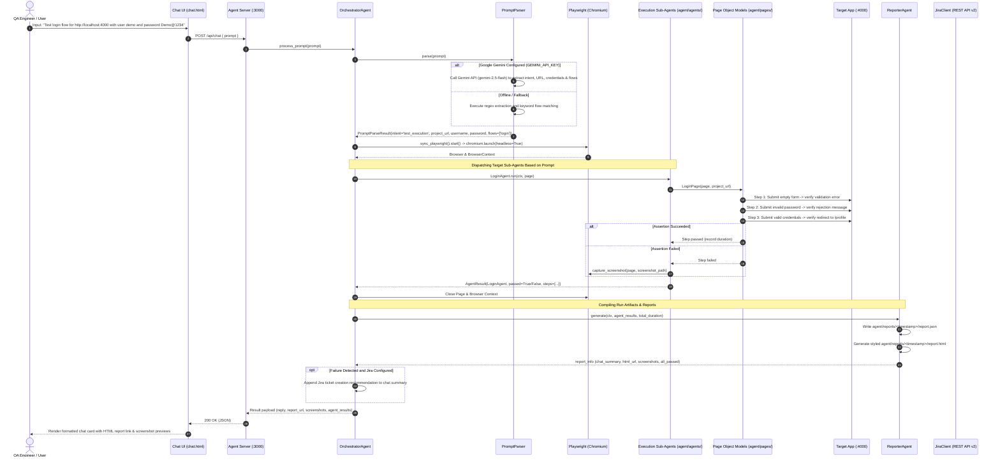
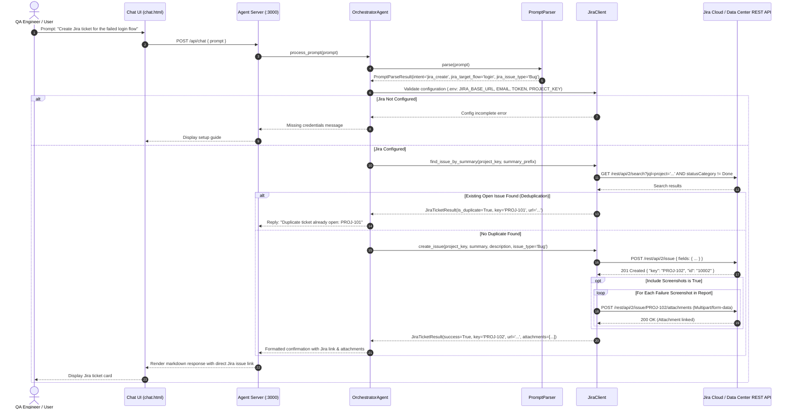

# AI Automation Tester — Comprehensive Project Architecture

This document provides a comprehensive technical architecture and operational reference for the **AI Automation Tester** system. It details the complete folder structure, component layers, text diagrams, visual sequence flows (Mermaid), and end-to-end execution lifecycles across Google Gemini, Playwright, Flask, and Atlassian Jira Cloud/Data Center.

---

## 1. Folder & File Structure

Below is the verified directory tree of the workspace, followed by technical descriptions for every module, script, and artifact.

```text
ai-automation-tester/
│
├── .env                              # Active runtime environment variables (PORT, HEADLESS, GEMINI_API_KEY, JIRA_*)
├── .env.example                      # Configuration template with Jira and Gemini variables
├── .gitignore                        # Git exclusion rules (__pycache__, .venv, reports, *.png, etc.)
├── mypy.ini                          # Strict static type-checking configuration (--strict, disallow_untyped_defs)
├── pytest.ini                        # Pytest runner configuration, test paths, and chromium flags
├── requirements.txt                  # Production & development dependencies (flask, pydantic, playwright, google-genai, requests, etc.)
├── run.py                            # Unified CLI task runner (dummy, agent, dev, test)
├── README.md                         # Quickstart overview, agent addition guide, and setup instructions
├── PROJECT_ARCHITECTURE.md           # Complete technical architecture and sequence flow documentation
├── AI_AUTOMATION_TESTER_HINGLISH_GUIDE.md # Comprehensive 12-chapter beginner-to-advanced Hinglish learning guide
│
├── agent/                            # AI Test Engine Package
│   ├── __init__.py                   # Agent package initializer
│   ├── agent.py                      # Re-export compatibility layer (AutomationAgent = OrchestratorAgent)
│   ├── models.py                     # Pydantic v2 data models & validation contracts (TestContext, StepResult, JiraTicketResult, etc.)
│   ├── server.py                     # Flask web server for Chat UI (:3000), /api/chat endpoint, and report serving
│   │
│   ├── orchestrator/                 # Workflow Orchestration & Language Intelligence
│   │   ├── __init__.py               # Package initializer
│   │   ├── orchestrator_agent.py     # Main Workflow Controller (OrchestratorAgent) coordinating agents, Jira, and Playwright
│   │   └── prompt_parser.py          # Google Gemini (gemini-2.5-flash) parser + Regex fallback with intent & flow extraction
│   │
│   ├── agents/                       # Flow-Specific Execution Sub-Agents
│   │   ├── __init__.py               # Sub-agents package initializer
│   │   ├── base_agent.py             # Abstract base agent with timing, error capture, and failure screenshots
│   │   ├── registration_agent.py     # Registration flow sub-agent (negative validations + dynamic unique user registration)
│   │   ├── login_agent.py            # Login flow sub-agent (empty credentials, invalid password, valid auth & redirect)
│   │   ├── profile_agent.py          # Profile management sub-agent (verification, name/phone update, reload persistence, logout)
│   │   └── reporter_agent.py         # Report generation agent (compiles metrics, writes report.json and interactive report.html)
│   │
│   ├── test_cases/                   # Modular Test Case Repository
│   │   ├── __init__.py               # Test case registry mapping (TEST_CASE_REGISTRY)
│   │   ├── base_case.py              # BaseTestCase with execution tracking and screenshot handling
│   │   ├── registration_cases.py     # Modular test cases for user registration flows
│   │   ├── login_cases.py            # Modular test cases for authentication and login flows
│   │   └── profile_cases.py          # Modular test cases for profile viewing, editing, persistence, and logout
│   │
│   ├── pages/                        # Page Object Model (POM) Abstractions
│   │   ├── __init__.py               # Pages package initializer
│   │   ├── registration_page.py      # Registration DOM locators (inputs, buttons, alerts) and UI interactions
│   │   ├── login_page.py             # Login DOM locators, inputs, error extraction, and submission
│   │   └── profile_page.py           # Profile DOM locators, edit toggles, input fields, flash messages, and logout
│   │
│   ├── integrations/                 # Third-Party Service Connectors
│   │   ├── __init__.py               # Integrations package initializer
│   │   ├── jira_config.py            # Jira configuration loader, URL sanitization, and credential validation
│   │   └── jira_client.py            # Typed Jira REST API v2 client (auth, project check, duplicate detection, issue creation, screenshot upload)
│   │
│   ├── chat/                         # Web Chat Interface Assets
│   │   └── chat.html                 # Modern responsive chat UI with markdown rendering, badge filters, and report links
│   │
│   ├── utils/                        # Shared Helper Utilities
│   │   ├── __init__.py               # Utils package initializer
│   │   ├── data_generator.py         # Dynamic random username, email, and phone generation
│   │   ├── logger.py                 # Structured console logger with credential masking
│   │   └── screenshot.py             # Playwright full-page failure screenshot capture utility
│   │
│   ├── reports/                      # Timestamped Test Execution Artifacts
│   │   └── <timestamp>/              # Individual test run directory (e.g. 20261021_143000)
│   │       ├── report.json           # Machine-readable test execution report with metrics and step logs
│   │       ├── report.html           # Human-readable responsive HTML dashboard report with failure highlights
│   │       └── *.png                 # High-resolution full-page screenshots captured upon failure
│   │
│   └── tests/                        # Standalone Pytest Test Suite
│       ├── __init__.py               # Tests package initializer
│       ├── conftest.py               # Shared fixtures: browser/context management & automatic background dummy app starter
│       ├── test_registration.py      # Standalone Pytest specifications for registration flow
│       ├── test_login.py             # Standalone Pytest specifications for login flow
│       ├── test_profile.py           # Standalone Pytest specifications for profile management flow
│       └── test_jira.py              # Mock and integration test suite for Jira client, config, issue creation, and deduplication
│
└── dummy_app/                        # Target Web Application Under Test
    ├── server.py                     # Flask server (:4000) with REST API, sessions, and in-memory mock database (users_db)
    └── public/                       # Front-end static templates with data-testid attributes
        ├── register.html             # User registration UI
        ├── login.html                # User login UI
        └── profile.html              # User profile management and editing UI
```

---

## 2. System Architecture Diagrams

### 2.1 High-Level Architecture Flow (Text Diagram)

```text
+---------------------------------------------------------------------------------------------------+
|                                          USER / QA TESTER                                         |
+-------------------------------------------------+-------------------------------------------------+
                                                  |
              (1) Enters prompt (e.g., "Test login flow for http://localhost:4000..." 
                                 or "Check Jira connection" or "Create Jira ticket")
                                                  |
                                                  v
+---------------------------------------------------------------------------------------------------+
|                                  AGENT SERVER (Flask @ Port 3000)                                 |
|  [GET  /chat]              --> Serves modern responsive chat web interface                        |
|  [POST /api/chat]          --> Receives { "prompt": "..." } and triggers OrchestratorAgent        |
|  [GET  /reports/<path>]    --> Serves timestamped report.html, report.json, and PNG screenshots    |
+-------------------------------------------------+-------------------------------------------------+
                                                  |
                                (2) Invokes orchestrator.process_prompt()
                                                  |
                                                  v
+---------------------------------------------------------------------------------------------------+
|                                         ORCHESTRATOR AGENT                                        |
|                                                                                                   |
|  +---------------------------------------------------------------------------------------------+  |
|  | PromptParser:                                                                               |  |
|  |   - Primary: Google Gemini API (gemini-2.5-flash) via GEMINI_API_KEY                        |  |
|  |   - Fallback: Regex extraction + intent detection                                            |  |
|  |   - Extracted Intents: 'test_execution' | 'jira_status' | 'jira_create'                     |  |
|  |   - Target Flows: ['registration', 'login', 'profile'] (or user-filtered subset)            |  |
|  +----------------------------------------------+----------------------------------------------+  |
|                                                 |                                                 |
|          +--------------------------------------+--------------------------------------+          |
|          | (Intent: jira_status / jira_create)                                         | (Intent: test_execution)
|          v                                                                             v          |
|  +---------------------------------------------+              +--------------------------------+  |
|  | JIRA INTEGRATION LAYER                      |              | PLAYWRIGHT BROWSER ENGINE      |  |
|  |  - JiraConfig (.env validation)             |              |  - sync_playwright()           |  |
|  |  - JiraClient (REST API v2)                 |              |  - chromium.launch(headless)   |  |
|  |  - Connection & project validation          |              |  - browser.new_context()       |  |
|  |  - Deduplication check (existing issues)   |              |  - context.new_page()          |  |
|  |  - Issue creation with reproduction steps   |              +----------------+---------------+  |
|  |  - Multipart screenshot attachments upload  |                               |                  |
|  +---------------------------------------------+                               | Dispatches       |
+--------------------------------------------------------------------------------|------------------+
                                                                                 |
                                                  +------------------------------+
                                                  |
                                                  v
+---------------------------------------------------------------------------------------------------+
|                               SUB-AGENT EXECUTION PIPELINE (Modular)                              |
|                                                                                                   |
|   1. RegistrationAgent  --> Tests empty form, invalid email, password mismatch, dynamic register |
|   2. LoginAgent         --> Tests empty inputs, wrong password, valid authentication redirect     |
|   3. ProfileAgent       --> Verifies data, updates name & phone, validates reload persistence, logout |
|                                                                                                   |
|   * Underlying Implementation: TestCases (agent/test_cases/) + Page Object Models (agent/pages/)  |
+-------------------------------------------------+-------------------------------------------------+
                                                  |
                             (3) Executes automated browser actions
                                                  |
                                                  v
+---------------------------------------------------------------------------------------------------+
|                               TARGET APPLICATION (Dummy App @ Port 4000)                          |
|  - Web Pages:  /register , /login , /profile (rich DOM with data-testid attributes)               |
|  - REST API:   /api/register , /api/login , /api/profile , /api/logout                            |
|  - State:      Thread-safe in-memory user registry (users_db)                                     |
+-------------------------------------------------+-------------------------------------------------+
                                                  |
                             (4) Results and step timings collected
                                                  |
                                                  v
+---------------------------------------------------------------------------------------------------+
|                                          REPORTER AGENT                                           |
|  - Aggregates pass/fail status, individual step timings, and execution metrics                    |
|  - Triggers capture_screenshot() on assertion or execution failure                                |
|  - Writes structured agent/reports/<timestamp>/report.json                                        |
|  - Generates responsive interactive agent/reports/<timestamp>/report.html                         |
|  - Embeds failure screenshots, logs, and reproduction details                                     |
+-------------------------------------------------+-------------------------------------------------+
                                                  |
                             (5) Structured JSON response returned to Chat UI
                                                  |
                                                  v
+---------------------------------------------------------------------------------------------------+
|                                        USER CHAT INTERFACE                                        |
|  - Displays executive summary card, execution status badge (Passed / Failed)                     |
|  - Provides direct clickable link to full HTML Dashboard report                                   |
|  - Renders inline failure screenshots (if any failure occurred)                                   |
|  - Provides one-click prompt suggestion to create Jira bug ticket with reproduction logs          |
+---------------------------------------------------------------------------------------------------+
```

---

### 2.2 Sequence Diagram: End-to-End Test Execution Flow



---

### 2.3 Sequence Diagram: Jira Integration & Bug Ticket Creation Flow



---

## 3. Component & Architectural Layers

### 3.1 Layer Breakdown

```text
+-------------------------------------------------------------------------------------+
|                                PRESENTATION LAYER                                   |
|   - Flask Web App (agent/server.py)                                                 |
|   - Modern Responsive Chat UI (agent/chat/chat.html)                                |
|   - Standalone Test Reports Dashboard (agent/reports/<ts>/report.html)              |
+-------------------------------------------------------------------------------------+
                                          |
                                          v
+-------------------------------------------------------------------------------------+
|                               ORCHESTRATION & AI LAYER                              |
|   - OrchestratorAgent (agent/orchestrator/orchestrator_agent.py)                    |
|   - PromptParser (agent/orchestrator/prompt_parser.py)                              |
|     * Google Gemini 2.5 Flash API integration                                       |
|     * Deterministic Regex & Keyword Fallback Engine                                 |
|     * Intent Routing ('test_execution', 'jira_status', 'jira_create')               |
+-------------------------------------------------------------------------------------+
                                          |
                                          v
+-------------------------------------------------------------------------------------+
|                             EXECUTION SUB-AGENTS LAYER                              |
|   - BaseAgent: Timing, logging, exception capture, screenshot handling              |
|   - RegistrationAgent: Negative form checks & dynamic user account creation         |
|   - LoginAgent: Authentication checks, validation errors & successful redirects      |
|   - ProfileAgent: Profile verification, data updates, reload persistence, logout    |
|   - ReporterAgent: Aggregates metrics, writes report.json, renders report.html      |
+-------------------------------------------------------------------------------------+
                                          |
                                          v
+-------------------------------------------------------------------------------------+
|                            TEST CASES & PAGE OBJECT MODEL                           |
|   - Test Cases (agent/test_cases/): BaseTestCase, Registration, Login, Profile      |
|   - Page Object Models (agent/pages/): Encapsulates DOM locators & interactions     |
|   - Browser Engine: Playwright (sync API) with Chromium browser                     |
+-------------------------------------------------------------------------------------+
                                          |
                                          v
+-------------------------------------------------------------------------------------+
|                            INTEGRATIONS & UTILITY LAYER                             |
|   - JiraClient: Typed REST API v2 connector with basic auth, PAT, multipart upload   |
|   - JiraConfig: Environment variable validation and URL sanitizer                   |
|   - DataGenerator: Dynamic randomized names, emails, and phone numbers              |
|   - Logger: Credential-masked structured console logging                            |
|   - Screenshot: Playwright automated full-page artifact capture                     |
+-------------------------------------------------------------------------------------+
```

---

## 4. Third-Party Dependencies

| Package | Version | Layer / Component | Architectural Role & Implementation Details |
| :--- | :--- | :--- | :--- |
| **`google-genai`** | `>=2.0` | Natural Language Parsing (`agent/orchestrator/prompt_parser.py`) | Connects to the **Google Gemini API** (`gemini-2.5-flash`) using `GEMINI_API_KEY`. Extracts target URL, credentials, requested test flows, and Jira intents from conversational instructions. |
| **`playwright`** | `>=1.44` | Browser Automation (`agent/agents/*`, `agent/pages/*`, `agent/test_cases/*`) | Controls headless Chromium using Playwright's synchronous API (`sync_playwright`). Executes DOM clicks, typing, navigation, reload persistence verification, and full-page failure screenshots. |
| **`flask`** | `>=3.0` | Web Application Engine (`agent/server.py`, `dummy_app/server.py`) | 1. Powers the Agent Server (routes `/chat`, `/api/chat`, `/reports/<path>`).<br>2. Powers the test subject dummy web app (routes `/login`, `/register`, `/profile`, and REST API endpoints). |
| **`pydantic`** | `>=2.6` | Data Validation & Contracts (`agent/models.py`) | Enforces typed schema validation for `TestContext`, `StepResult`, `AgentResult`, `PromptParseResult`, `JiraTicketResult`, and `OrchestratorResult`. |
| **`requests`** | `>=2.31.0` | Jira REST API Client (`agent/integrations/jira_client.py`) | Executes authenticated HTTP calls to Atlassian Jira REST API v2 for connection validation, project verification, issue search/deduplication, issue creation, and multipart screenshot attachment uploads. |
| **`python-dotenv`** | `>=1.0` | Configuration Management (`agent/server.py`, `run.py`, `jira_config.py`) | Loads runtime configurations from `.env` (`PORT`, `HEADLESS`, `GEMINI_API_KEY`, `JIRA_*`) into `os.environ`. |
| **`pytest`** | `>=8.0` | Standalone CLI Test Runner (`agent/tests/`) | Enables command-line test execution via `python run.py test` or CI/CD pipelines. |
| **`pytest-playwright`**| `>=0.5` | Pytest Plugin (`agent/tests/conftest.py`) | Injects managed Playwright browser fixtures into standalone Pytest test specifications. |
| **`mypy`** | `>=1.10` | Static Type Checker | Enforces strict static typing (`--strict`, `disallow_untyped_defs = True`) across all codebase modules. |

---

## 5. Dynamic Flow Execution & Prompt Handling

The system parses natural language instructions and dynamically dispatches only the requested flows:

### 5.1 Supported Natural Language Prompts

| Intent | Sample User Prompt | Action Taken |
| :--- | :--- | :--- |
| **Login Flow Only** | `Test login flow for http://localhost:4000 with login credentials: username demo and password Demo@1234` | Executes only `LoginAgent` (empty form, wrong password, successful authentication & redirect). |
| **Registration Flow Only**| `Test registration flow for http://localhost:4000 with login credentials: username demo and password Demo@1234` | Executes only `RegistrationAgent` (empty fields, invalid email, password mismatch, dynamic registration). |
| **Profile Flow Only** | `Test profile flow for http://localhost:4000 with login credentials: username demo and password Demo@1234` | Executes only `ProfileAgent` (authentication, profile inspection, name/phone update, persistence across reload, logout). |
| **All Test Flows** | `Test all cases: http://localhost:4000 with login credentials: username demo and password Demo@1234` | Executes `RegistrationAgent` → `LoginAgent` → `ProfileAgent` in complete sequence. |
| **Jira Status Check** | `Jira status` or `Check Jira connection` | Invokes `jira_client.validate_connection()` and `validate_project()`, returning user and project validation status. |
| **Jira Ticket Creation** | `Create Jira ticket for the failed login flow` | Scans the most recent run results or saved reports, extracts reproduction steps and screenshots, and creates a Jira Bug. |

---

## 6. Jira Cloud & Data Center Integration Architecture

### 6.1 Configuration Schema (`.env`)

```env
JIRA_BASE_URL=https://your-domain.atlassian.net
JIRA_EMAIL=your-email@example.com
JIRA_API_TOKEN=your-atlassian-api-token
JIRA_PROJECT_KEY=KAN
JIRA_DEFAULT_ISSUE_TYPE=Bug
```

### 6.2 Key Jira Capabilities

1. **URL Sanitization & Format Normalization**:
   - `JiraConfig.normalize_base_url()` automatically strips trailing slashes and handles both Jira Cloud and self-hosted Jira Data Center instances.
2. **Authentication**:
   - **Jira Cloud**: Basic Authentication using `email` and `api_token` via `HTTPBasicAuth`.
   - **Jira Data Center / Server**: Bearer Personal Access Token (PAT) via `Authorization: Bearer <token>`.
3. **Connection & Project Validation**:
   - `GET /rest/api/2/myself`: Verifies credentials and retrieves display name.
   - `GET /rest/api/2/project/{key}`: Verifies project permissions and discovers valid issue types.
4. **Duplicate Issue Prevention (Deduplication)**:
   - Before filing a new issue, `find_issue_by_summary()` queries Jira using JQL (`project = '{key}' AND statusCategory != Done`).
   - If an open bug with the same failure summary already exists, the agent returns the existing ticket URL instead of creating a duplicate.
5. **Multipart Screenshot Attachment**:
   - High-resolution full-page screenshots captured during failed Playwright steps are uploaded directly to the created Jira issue via `POST /rest/api/2/issue/{key}/attachments` with `X-Atlassian-Token: no-check`.

---

## 7. Quick Execution & Command Reference

| Action | Command | Description |
| :--- | :--- | :--- |
| **Run Both Servers (Dev)** | `python run.py dev` | Starts Dummy App (`:4000`) and Agent Server (`:3000`) concurrently. |
| **Run Dummy App Server** | `python run.py dummy` | Starts target app on `http://127.0.0.1:4000`. |
| **Run Agent Server** | `python run.py agent` | Starts Agent interface on `http://127.0.0.1:3000`. |
| **Run Pytest Test Suite** | `python run.py test` | Executes all 8 automated flow tests and Jira test specifications via Pytest. |
| **Run Jira Test Suite** | `pytest agent/tests/test_jira.py -v` | Executes unit and mock tests for Jira integration. |
| **Strict Type Checking** | `mypy --config-file mypy.ini agent` | Validates strict static typing across all agent modules. |
| **Access Web Chat UI** | Browser: `http://localhost:3000/chat` | Main conversational interface for entering testing prompts. |
| **Access Target App** | Browser: `http://localhost:4000/login` | Direct manual access to the target web application. |
