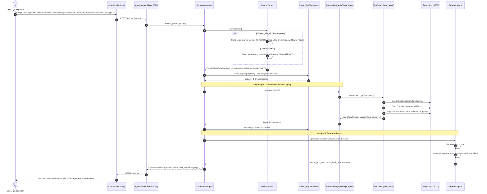

# AI Automation Tester — Comprehensive Project Documentation

This document provides a complete technical reference for the **AI Automation Tester** system, including its folder structure, text-based and visual sequence flows, and the end-to-end operational lifecycle with Google Gemini and Playwright.

---

## 1. Folder Structure

Below is the directory tree of the workspace, followed by descriptions for every file and module.

```text
ai-automation-tester/
│
├── .env                              # Active environment variables (PORT, HEADLESS, GEMINI_API_KEY)
├── .env.example                      # Template for environment configuration
├── .gitignore                        # Git exclusion rules (__pycache__, .venv, reports, etc.)
├── mypy.ini                          # Strict static type-checking configuration
├── pytest.ini                        # Pytest runner flags, root directories, and test paths
├── requirements.txt                  # Production and development dependencies
├── run.py                            # Unified CLI task runner (dummy, agent, dev, test)
├── README.md                         # Project overview and quickstart guide
├── PROJECT_DOCUMENTATION.md          # Complete architectural and flow documentation
│
├── agent/                            # AI Test Engine Package
│   ├── __init__.py                   # Agent package initializer
│   ├── agent.py                      # SINGLE UNIFIED AGENT (AutomationAgent)
│   ├── models.py                     # Pydantic v2 data models & schema contracts
│   ├── server.py                     # Flask web server for the Chat UI and /api/chat endpoint
│   │
│   ├── integrations/                 # Third-Party Service Integrations
│   │   ├── __init__.py               # Integrations package initializer
│   │   ├── jira_config.py            # Jira environment configuration & URL sanitizer
│   │   └── jira_client.py            # Typed Jira REST API v2 client (auth, create, deduplicate, upload)
│   │
│   ├── orchestrator/                 # Natural Language Prompt Parsing
│   │   ├── __init__.py               # Package initializer
│   │   └── prompt_parser.py          # Google Gemini parser + Regex fallback with dynamic flow detection
│   │
│   ├── test_cases/                   # Modular Test Case Repository
│   │   ├── __init__.py               # Test cases package initializer and test case registry
│   │   ├── base_case.py              # BaseTestCase with execution tracking and screenshot handling
│   │   ├── registration_cases.py     # Registration flow test cases (empty form, bad email, mismatch, success)
│   │   ├── login_cases.py            # Login flow test cases (empty inputs, invalid password, valid auth & redirect)
│   │   └── profile_cases.py          # Profile flow test cases (auth, verify data, update name/phone, persistence, logout)
│   │
│   ├── pages/                        # Page Object Model (POM) abstractions
│   │   ├── __init__.py               # Pages package initializer
│   │   ├── registration_page.py      # Registration DOM locators and page interactions
│   │   ├── login_page.py             # Login DOM locators and actions
│   │   └── profile_page.py           # Profile DOM locators, inputs, notifications, and actions
│   │
│   ├── chat/                         # Web Chat Interface assets
│   │   └── chat.html                 # Modern responsive chat interface served at /chat
│   │
│   ├── utils/                        # Shared utility modules
│   │   ├── __init__.py               # Utils package initializer
│   │   ├── data_generator.py         # Dynamic random username, email, and phone generation
│   │   ├── logger.py                 # Structured console logger with credential masking
│   │   └── screenshot.py             # Playwright failure screenshot capture helper
│   │
│   ├── reports/                      # Timestamped test run artifacts
│   │   └── <timestamp>/              # Individual run directory
│   │       ├── report.json           # Machine-readable test execution report
│   │       ├── report.html           # Human-readable responsive HTML dashboard report
│   │       └── *.png                 # Captured failure screenshots (if any)
│   │
│   └── tests/                        # Standalone Pytest test specifications
│       ├── __init__.py               # Tests package initializer
│       ├── conftest.py               # Shared fixtures (Playwright browser & context setup)
│       ├── test_registration.py      # Pytest specifications for registration flow
│       ├── test_login.py             # Pytest specifications for login flow
│       └── test_profile.py           # Pytest specifications for profile management flow
│
└── dummy_app/                        # Target Web Application (Test Subject)
    ├── server.py                     # Flask server with REST API and in-memory mock database
    └── public/                       # Static front-end web pages
        ├── register.html             # User registration UI
        ├── login.html                # User login UI
        └── profile.html              # User profile viewing and updating UI
```

---

## 2. Text Diagram Flow

### 2.1 High-Level Architecture Flow (Text Diagram)

```text
+-----------------------------------------------------------------------------------+
|                                  USER / TESTER                                    |
+-----------------------------------------+-----------------------------------------+
                                          |
        (1) Submits instruction via Chat UI (e.g., "Test login flow..." or "Test all...")
                                          |
                                          v
+-----------------------------------------------------------------------------------+
|                        AGENT SERVER (Flask @ Port 3000)                           |
|  [GET /chat]         --> Serves modern chat interface                             |
|  [POST /api/chat]    --> Receives { "prompt": "..." }                             |
|  [GET /reports/...]  --> Serves generated HTML/JSON reports & screenshots        |
+-----------------------------------------+-----------------------------------------+
                                          |
                        (2) Calls orchestrator.process_prompt()
                                          |
                                          v
+-----------------------------------------------------------------------------------+
|                               ORCHESTRATOR AGENT                                  |
|                                                                                   |
|  +-----------------------------------------------------------------------------+  |
|  | PromptParser:                                                               |  |
|  |   - Primary: Google Gemini API (gemini-2.5-flash via GEMINI_API_KEY)        |  |
|  |   - Fallback: Regex extraction + intent detection for target flows          |  |
|  |   - Dynamic Flows: ['login'], ['registration'], ['profile'], or all        |  |
|  +-------------------------------------+---------------------------------------+  |
|                                        |                                          |
|                                        v Constructs TestContext(flows=[...])      |
|  +-----------------------------------------------------------------------------+  |
|  | Playwright Engine: sync_playwright().start() -> chromium.launch()           |  |
|  +-------------------------------------+---------------------------------------+  |
+----------------------------------------|------------------------------------------+
                                         |
               (3) Dispatches SINGLE AGENT with Target Flows
                                         |
                                         v
+-----------------------------------------------------------------------------------+
|                                AUTOMATION AGENT                                   |
|                        (Single Unified Testing Agent)                             |
|                                                                                   |
|  Reads ctx.flows and dynamically executes only the requested test cases           |
|  from the `agent/test_cases/` folder:                                             |
|                                                                                   |
|       +-------------------------------------------------------------------+       |
|       |                     TEST CASES REPOSITORY                         |       |
|       |                                                                   |       |
|       |  [RegistrationTestCases]  --> agent/test_cases/registration_cases |       |
|       |  [LoginTestCases]         --> agent/test_cases/login_cases        |       |
|       |  [ProfileTestCases]       --> agent/test_cases/profile_cases      |       |
|       +---------------------------------+---------------------------------+       |
+-----------------------------------------|-----------------------------------------+
                                          |
                     (4) Page Object Model (POM) Actions
                                          |
                                          v
+-----------------------------------------------------------------------------------+
|                      TARGET APPLICATION (Dummy App @ Port 4000)                   |
|  - Pages:    /register , /login , /profile                                        |
|  - REST API: /api/register , /api/login , /api/profile , /api/logout              |
|  - Storage:  Thread-safe in-memory database dictionary (users_db)                 |
+-----------------------------------------+-----------------------------------------+
                                          |
                        (5) Results collected per step
                                          |
                                          v
+-----------------------------------------------------------------------------------+
|                                 REPORTER AGENT                                    |
|  - Aggregates metrics: total steps, pass/fail counts, execution durations         |
|  - Writes agent/reports/<timestamp>/report.json                                   |
|  - Writes agent/reports/<timestamp>/report.html                                   |
|  - Captures full-page screenshots for any step failure                            |
+-----------------------------------------+-----------------------------------------+
                                          |
                      (6) OrchestratorResult returned to Chat UI
                                          |
                                          v
+-----------------------------------------------------------------------------------+
|                               USER CHAT INTERFACE                                 |
|  - Displays flow execution badges (e.g. "Flows: Login")                           |
|  - Renders direct clickable link to standalone HTML test report                   |
|  - Shows captured failure screenshot previews (if failures occurred)             |
+-----------------------------------------------------------------------------------+
```

---

### 2.2 Sequence Diagram (End-to-End Execution Flow)



---

## 3. Overall Project Flow with Third-Party Dependencies

### 3.1 Third-Party Libraries Breakdown

| Package | Version | Layer / Component | Primary Purpose & How It Is Used |
| :--- | :--- | :--- | :--- |
| **`google-genai`** | `>=2.0` | AI Parsing Engine (`agent/orchestrator/prompt_parser.py`) | Communicates with the **Google Gemini API** (`gemini-2.5-flash`) via `GEMINI_API_KEY` to extract project URLs, usernames, passwords, and target flows from conversational user prompts. |
| **`playwright`** | `>=1.44` | Test Execution Engine (`agent/test_cases/*`, `agent/pages/*`) | Drives Chromium via Playwright's synchronous API (`sync_playwright`). Executes DOM clicks, typing, navigation, reload persistence checks, and automated screenshot captures. |
| **`flask`** | `>=3.0` | Web Applications (`agent/server.py`, `dummy_app/server.py`) | 1. Powers the Agent Server (routes `/chat`, `/api/chat`, `/reports/<path>`).<br>2. Powers the dummy web app under test (routes `/login`, `/register`, `/profile`, `/api/*`). |
| **`pydantic`** | `>=2.6` | Data Validation & Contracts (`agent/models.py`) | Validates and serializes schema contracts: `TestContext`, `StepResult`, `AgentResult`, `PromptParseResult`, and `OrchestratorResult`. |
| **`python-dotenv`** | `>=1.0` | Configuration (`agent/server.py`, `run.py`) | Loads runtime configurations from `.env` (`PORT`, `HEADLESS`, `GEMINI_API_KEY`) into `os.environ`. |
| **`pytest`** | `>=8.0` | Standalone CLI Test Runner (`agent/tests/`) | Enables running the test suite via continuous integration (`python run.py test`). |
| **`pytest-playwright`**| `>=0.5` | Pytest Plugin (`agent/tests/conftest.py`) | Injects managed Playwright browser and page fixtures into Pytest test cases. |
| **`mypy`** | `>=1.10` | Static Type Checker | Enforces strict static type safety (`--strict`) across all modules. |

---

### 3.2 Dynamic Flow Execution Mechanics

The system supports prompt-driven execution where the **single Automation Agent** selectively runs test cases:

1. **Login Flow Only**:
   - Prompt: `Test login flow for http://localhost:4000 with login credentials: username demo and password Demo@1234`
   - Flow Selected: `['login']`
   - Test Cases Executed: `LoginTestCases` (Empty credentials, wrong password, valid login & redirect).

2. **Registration Flow Only**:
   - Prompt: `Test registration flow for http://localhost:4000 with login credentials: username demo and password Demo@1234`
   - Flow Selected: `['registration']`
   - Test Cases Executed: `RegistrationTestCases` (Empty form, invalid email, password mismatch, valid dynamic user registration).

3. **Profile Flow Only**:
   - Prompt: `Test profile flow for http://localhost:4000 with login credentials: username demo and password Demo@1234`
   - Flow Selected: `['profile']`
   - Test Cases Executed: `ProfileTestCases` (Authenticate, verify user data, edit name/phone, verify persistence across page reload, logout).

4. **All Test Cases**:
   - Prompt: `Test all cases: http://localhost:4000 with login credentials: username demo and password Demo@1234`
   - Flows Selected: `['registration', 'login', 'profile']`
   - Test Cases Executed: All test case suites run in sequence.

5. **Failure Screenshots & Reporting**:
   - If any assertion fails in any test case, `capture_screenshot()` saves a full-page image into `agent/reports/<timestamp>/<step_name>.png`.
   - The interactive `report.html` and `report.json` embed the screenshots and highlight the failure details.

---

## 4. Quick Execution Reference

| Action | Command | Description |
| :--- | :--- | :--- |
| **Run Both Servers** | `python run.py dev` | Starts Dummy App (`:4000`) and Agent Server (`:3000`) concurrently |
| **Run Dummy App** | `python run.py dummy` | Starts target app on `http://127.0.0.1:4000` |
| **Run Agent Server** | `python run.py agent` | Starts Agent interface on `http://127.0.0.1:3000` |
| **Run Pytest Suite** | `python run.py test` | Executes all 8 automated flow tests via Pytest + Playwright |
| **Type Check** | `mypy --config-file mypy.ini agent` | Runs strict static type validation |
